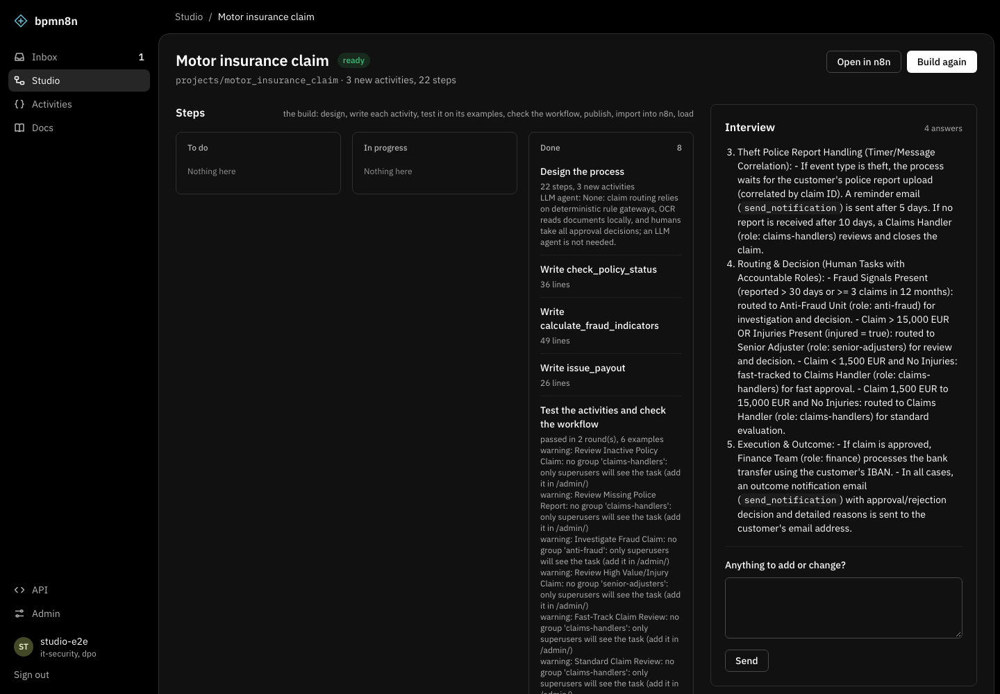
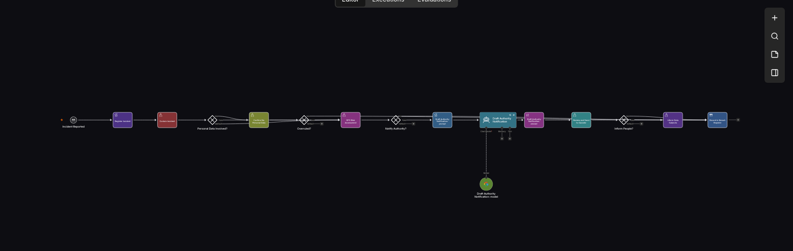
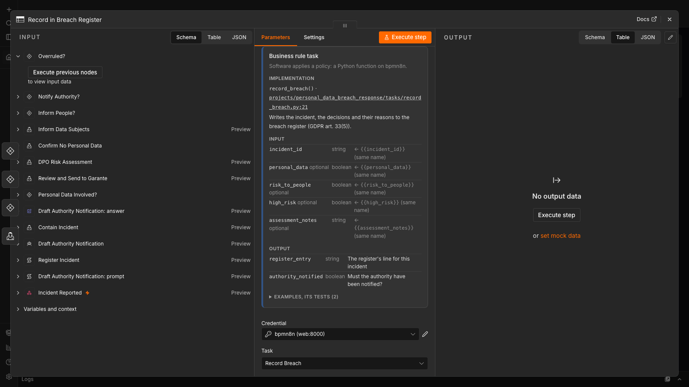
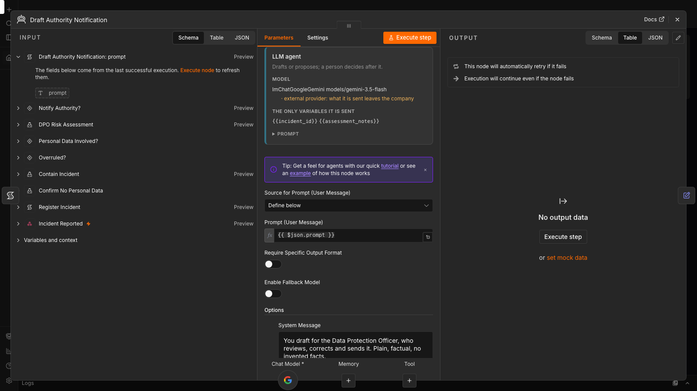
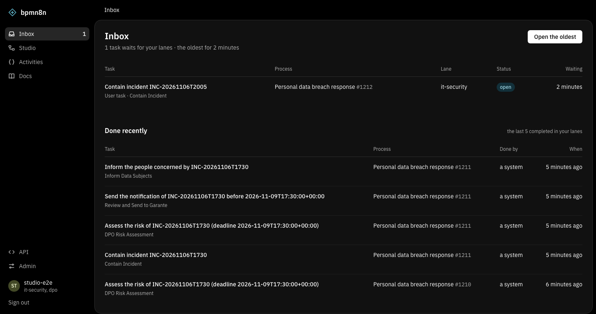
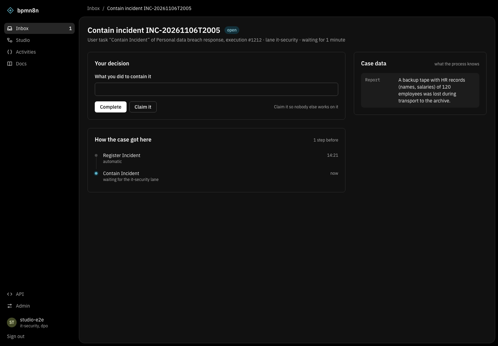

<div align="center">

# bpmn8n

**BPMN workflows on n8n, checked before they run.**

Draw real BPMN on the n8n canvas. Describe a process in plain words and an LLM researches the domain, interviews you and builds it. A workflow check catches what n8n would only reveal when a case gets stuck.


</div>

---

## Why

n8n runs workflows well, but it does not speak the language of business processes, and a broken branch only shows up when a real case reaches it. bpmn8n adds the missing layer:

| | |
|---|---|
| 🔷 **Real BPMN** | 14 nodes (tasks, gateways, events) drawn with the official BPMN 2.0 symbols. Shapes, markers and line weights follow bpmn.io. |
| 🧠 **Studio** | Say what the process is. The LLM searches the web for the domain's rules, asks you one question at a time, then writes the activities and the workflow. |
| ✅ **Workflow check** | Every activity is imported and run against its examples, and the workflow is analysed before anything is loaded. Only what passes is published. |
| 👤 **People in the loop** | User and Manual Tasks get a page generated from the form. Final decisions always go through a person. |
| 🤖 **Small models where they shine** | [GLiNER2.5](https://github.com/fastino-ai/GLiNER2) fills task inputs from free text, [Laya](https://github.com/NandhaKishorM/laya) decides gateways in about 20 ms, Vision reads scanned documents. |
| 📈 **Process mining** | Every step lands in an event log, ready for PM4Py. |

## Screenshots

| Studio: interview, build and who decides | The workflow in n8n, with the BPMN nodes |
|---|---|
|  |  |
| **A node's panel: the Python function behind it** | **An LLM agent: the only variables it is sent** |
|  |  |
| **The people inbox** | **A task: the form, the case data, how it got here** |
|  |  |

The screenshots show synthetic test processes (a data breach response, a motor insurance claim).

## How it fits together

```
 describe a process ─▶ Studio (research · interview · build) ─▶ checked project
                                                                    │
 n8n  ◀── BPMN nodes ── Django tasks (OpenAPI, auto-discovered) ◀───┘
  │
  └─▶ People inbox · event log · process mining
```

## Quick start

```bash
./start.sh            # builds the nodes and starts everything (safe to re-run)
./start.sh status     # what is running
./start.sh stop       # stop, data is kept
```

Then open:

| | |
|---|---|
| http://localhost:5678 | n8n, with the BPMN canvas |
| http://localhost:8000/studio/ | design a process with the LLM |
| http://localhost:8000/docs/ | the full guide |

**Needs:** Docker, Node.js and, on a Mac, [uv](https://docs.astral.sh/uv/). Add an LLM provider key in *Admin → Settings*, or point it to a local model.

## Local Ollama models and web research

Studio already supports Ollama through its OpenAI-compatible chat-completions API. Start Ollama, pull the model you want to use, then add an LLM provider in **Admin → Settings**:

| Field | Value |
|---|---|
| Preset | `ollama` |
| Model | The exact installed model tag shown by `ollama list` |
| Base URL with Django in Docker Desktop | Leave empty for `http://host.docker.internal:11434/v1` |
| Base URL with Django on the same host | `http://localhost:11434/v1` |
| API key | Empty for a local Ollama server |
| Timeout | Increase from 120 seconds if the model needs more time |

Choose that provider as the default LLM in Settings. The same provider can supply n8n workflow agent credentials. Both Django and the n8n worker must be able to reach the configured URL. On Linux Docker Engine, add `host.docker.internal:host-gateway` to the relevant services' `extra_hosts`, or use a reachable Ollama service address. Configure Ollama's listening interface for that network and restrict access to trusted clients.

The [Ollama API guide](https://docs.ollama.com/api/openai-compatibility) documents the compatible `/v1/chat/completions` endpoint.

### Domain research with a local model

The existing Studio research loop works with the default Ollama provider. Docker Compose includes SearXNG and sets `SEARCH_URL=http://searxng:8080` for Django. With Django outside Docker, set `SEARCH_URL` to a reachable SearXNG instance with its JSON API enabled. An empty value disables web research.

After creating a Studio project and describing the process, research runs before the interview. The model plans up to three searches, reads up to two results per query and looks for missing information in a second round. It writes domain notes with source URLs that the interview, design and activity generation can read. The interview can request two additional research jobs, for a maximum of three per project. Constants live in `bpmn8n/studio/research.py`.

For example, describe a hospital booking workflow and ask it to research appointment scheduling, service directories and staff handoffs. Supply the hospital's current rules and integrations during the interview. Check the research cards for notes and sources. If search fails, the interview continues with the information available. A local LLM keeps inference on your model server, while SearXNG queries and public page retrieval still use the network.

To check configuration, verify the exact model tag with `ollama list`, confirm that Django can reach `/v1/chat/completions`, and check that SearXNG returns JSON for `/search?q=hospital+appointment+workflow&format=json` from the Django network. Avoid personal patient data in public searches. Web research supports workflow design. Hospital adapters must provide current availability and eligibility at booking time.

## Claude as Studio's LLM (MCP)

bpmn8n is also an MCP server, so an MCP client can stand in for the LLM provider: no API key, and the client reads and drives the whole state. Claude Code picks it up from [`.mcp.json`](.mcp.json) when opened in this folder with the stack running (`docker compose exec -T web python manage.py mcp`; without Docker, `python manage.py mcp`).

| Tool | Does |
|---|---|
| `studio_projects`, `studio_project` | the projects and one project's state: interview, research, brief, spec, build cards |
| `studio_create`, `studio_prompt`, `studio_save`, `studio_write` | the client interviews, designs and writes the code, following Studio's own instructions and live context |
| `studio_check`, `studio_publish` | bpmn8n imports the modules, runs the examples, checks the workflow, then publishes and imports into n8n |
| `api` | any route of the REST API: user tasks, cases, messages, metrics, process mining, workflow checks |

Ask it, for example, *"design an expense approval process in bpmn8n Studio"* or *"which user tasks are open?"*.

The [MCP guide](docs/MCP.md) covers installing it in Claude Code, Claude Desktop or without Docker, every tool, building a process step by step, and troubleshooting.

## Python environment

Install Python 3.12 (minimum 3.11), then create the local environment from the repository root:

```bash
python tools/setup_env.py
# Include testing and browser dependencies:
python tools/setup_env.py --dev
```

On Windows with the Python launcher, use `py -3.12 tools/setup_env.py`. The script creates `.venv`, installs `requirements.txt` (or `requirements-dev.txt` with `--dev`) and can be rerun to update dependencies. It also works when invoked from another directory. Activate it with `.venv\Scripts\Activate.ps1` on PowerShell or `source .venv/bin/activate` on macOS/Linux. Then run `python manage.py migrate` and `python manage.py runserver`.

This sets up the Python application. Docker/Node.js, n8n, model servers and SearXNG have their own setup described above and in the guide. Browser tests also require `python -m playwright install chromium` after the development dependencies.

## One task, one function

```python
@task("businessRuleTask")
def check_expense_policy(request, data: Expense) -> PolicyCheck:
    """Per-person limit by category."""
    ...
```

It appears in the node's menu at once, with a typed form, validation and an OpenAPI entry.

## Hospital appointment use case

[UC-01 · Intelligent hospital appointment booking](projects/hospital/README.md) adds a patient request, review of service and dates, administrative validation, slot selection and reservation. It includes an importable [n8n workflow](projects/hospital/workflow.json), synthetic demo slots, typed task endpoints and recovery paths for changed availability or staff referral.

Four responsibilities follow the university project's agent taxonomy: Coordinator, Chat Agent, Classifier and Booker. The example runs against a local demonstration database. Follow its setup guide to connect Ollama, create the people-inbox groups and try the workflow.

```bash
python manage.py migrate
python manage.py loaddata hospital_demo
python manage.py test projects.hospital
```

## Learn more

The complete guide lives in [`docs/GUIDE.md`](docs/GUIDE.md): the nodes, the workflow check, Studio, people and states, extraction, OCR, process mining, BPMN coverage, tests and known limits.

The [hospital appointment project presentation](docs/presentations/hospital-appointment-management.pptx) covers the booking use case, four agent roles and their proposed course-pattern taxonomy, the complete editable workflow and its connection to bpmn8n. It contains 10 slides in English with speaker notes timed for a five-minute presentation.

## Contributors

- [@0negip](https://github.com/0negip) — hospital appointment example and presentation, Ollama documentation and regression tests, Python environment setup.

## Licence

[AGPL-3.0](LICENSE): free for everyone. If you offer a modified bpmn8n as a network service, you must publish your changes under the same licence. Need to use it in a closed product? Open an issue to ask about a commercial licence.

BPMN symbols come from [bpmn-font](https://github.com/bpmn-io/bpmn-font) (SIL OFL 1.1). Process mining uses [PM4Py](https://pm4py.fit.fraunhofer.de) (AGPL-3.0). More in the guide's *Licences* section.
